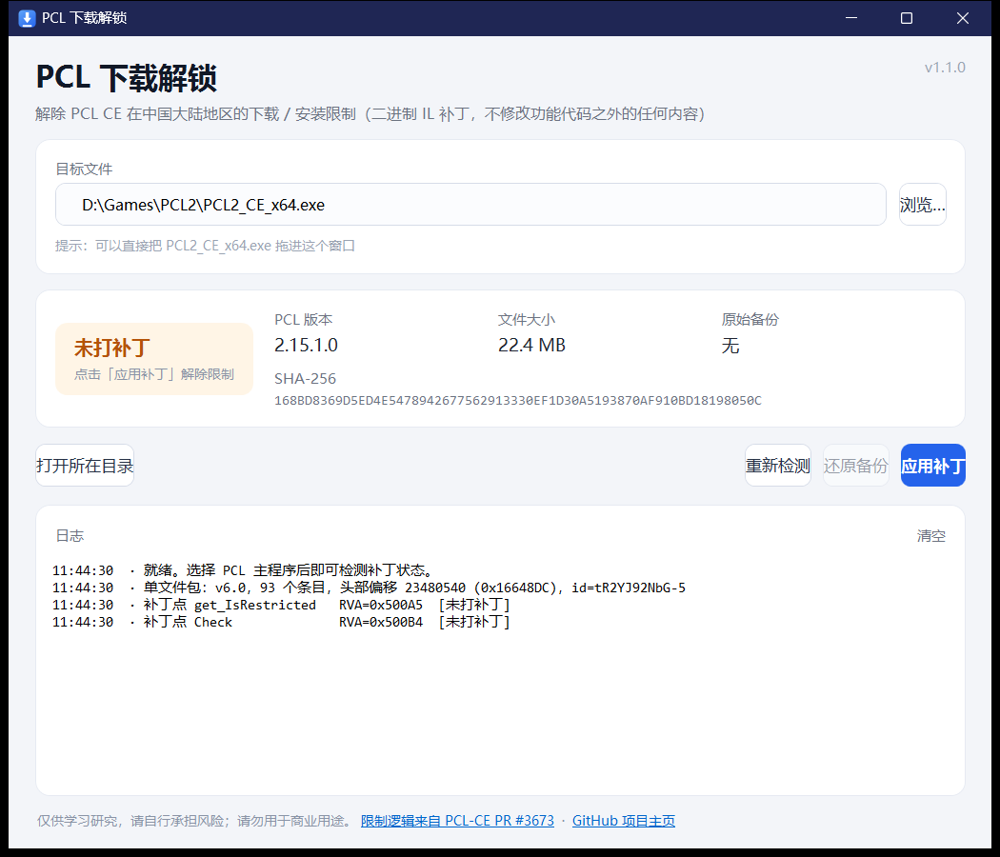

# PCL 下载解锁 · PCL Download Unlock

解除 **PCL CE（Plain Craft Launcher 2 社区版）** 在中国大陆地区被限制的**下载 / 安装**功能。

> 原理：只对 PCL 单文件包里的 `PCL.RestrictedFeaturePolicy` 两个方法做**等长二进制 IL 补丁**，
> 让「区域限制判定」恒为「未受限」。不改元数据、不改文件大小、不注入代码。



**直接下载**：[Releases](https://github.com/ailixiyaX/PCLDownloadUnlock/releases/latest)（Windows x64 单文件，无需安装 .NET）

## 它做了什么

PCL-CE 的 [PR #3673](https://github.com/PCL-Community/PCL-CE/pull/3673) 在 2.15.1 里引入了区域限制：
程序启动时读取 Windows 的「地理位置 / 区域 / 语言 / 时区」信号，判定为中国大陆时，
把「安装 Minecraft、下载游戏文件、下载整合包、补全资源」等入口全部拦掉。

所有拦截点都收敛到同一个门禁类型（在单文件包内的 `Plain Craft Launcher 2.dll` 里）：

| 方法 | 原始行为 | 补丁后 |
| --- | --- | --- |
| `PCL.RestrictedFeaturePolicy.Check(string, bool)` | 受区域限制时返回 `false` 并弹提示 | `ldc.i4.1; ret` → 恒 `true`（允许） |
| `PCL.RestrictedFeaturePolicy.get_IsRestricted()` | 受区域限制时返回 `true` | `ldc.i4.0; ret` → 恒 `false`（未受限） |

补丁同时把方法体的 `codeSize` 改成 2，避免 CoreCLR 因「ret 之后还有指令」抛 `InvalidProgramException`。

## 使用方法

1. 下载 `PCLDownloadUnlock.exe`（Windows x64，自包含单文件，无需装 .NET）。
2. **完全退出 PCL**（包括托盘图标）。
3. 运行本程序，确认「目标文件」指向 `PCL2_CE_x64.exe`（一般会自动检测，也支持拖放）。
4. 点「应用补丁」，看到「已打补丁」即可启动 PCL。

原文件会自动备份为同目录下的 `PCL2_CE_x64.exe.pclfix.bak`，
随时可以在本程序里点「还原备份」回到原始状态。

### 命令行

```bat
PCLDownloadUnlock.exe --check  "D:\minecraft\PCL2_CE_x64.exe"   :: 检测状态
PCLDownloadUnlock.exe          "D:\minecraft\PCL2_CE_x64.exe"   :: 打补丁
PCLDownloadUnlock.exe --revert "D:\minecraft\PCL2_CE_x64.exe"   :: 还原备份
PCLDownloadUnlock.exe --help
```

退出码：`0` 成功 · `1` 失败 · `2` 用法错误 · `3` 不是单文件包 · `4` 找不到补丁点 · `5` 写完校验失败 · `6` 文件被占用。

## 注意事项

- 只对**自带该区域限制逻辑的 PCL CE 构建**有效（目前是 2.15.1 及之后的社区版）。官方版 PCL2 / 其他启动器会提示「不适用」。
- PCL **每次更新**都会覆盖 exe，更新后需要重新打一次补丁。
- 补丁只改这两个方法的 IL，其余文件内容、签名、大小全部保持不变；但改过的 exe 与官方发布物的哈希不同，杀软可能提示。
- 仅供学习研究，请自行承担风险，请勿用于商业用途。

## 从源码构建

需要 .NET SDK 8.0+（Windows）：

```bat
dotnet publish src/PCLDownloadUnlock/PCLDownloadUnlock.csproj -c Release -r win-x64 ^
  --self-contained true -p:PublishSingleFile=true -o out
```

产物：`out/PCLDownloadUnlock.exe`。CI 也会在每次推送时自动构建并在 Release 里附上 exe。

## 致谢 / 相关链接

- PCL-CE：[PCL-Community/PCL-CE](https://github.com/PCL-Community/PCL-CE)
- 被禁用的功能来源：[PR #3673](https://github.com/PCL-Community/PCL-CE/pull/3673)
- 实现依赖 [System.Reflection.Metadata](https://learn.microsoft.com/dotnet/api/system.reflection.metadata)（.NET 自带，无第三方包）

## 许可证

[MIT](LICENSE)
